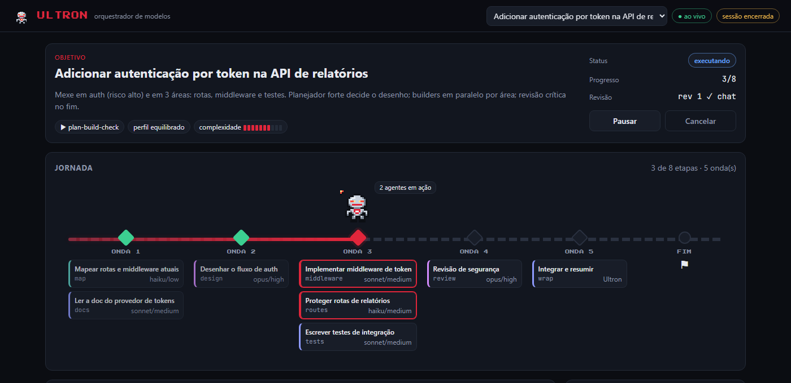
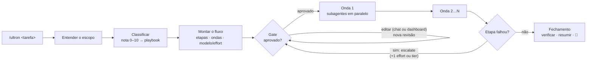

# Ultron Orchestrator

**Orquestração de modelos por etapa para o Claude Code.** Com `/ultron <tarefa>`, a sessão vira o **Ultron**: ele classifica a tarefa, monta um fluxo de etapas em que cada uma tem o **modelo** (Haiku, Sonnet ou Opus) e o **effort** que de fato precisa, pede sua aprovação e só então executa, delegando cada etapa a um subagente. Você acompanha a jornada num painel lateral no terminal e num dashboard local, com um mini Ultron em pixel art andando de etapa em etapa até a bandeira.



## Por que existe

Uma sessão do Claude Code roda inteira num modelo e num effort escolhidos no início. Na prática, quase toda tarefa mistura trabalho barato (mapear arquivos, escrever docs) com trabalho difícil (desenhar uma arquitetura, revisar segurança). Rodar tudo no modelo mais forte desperdiça orçamento, e rodar tudo no mais barato perde qualidade.

O Ultron separa a tarefa em etapas e escolhe o par modelo/effort de cada uma. Nada roda antes de você aprovar o plano. Inspirado no [alethe](https://github.com/Kc1t/alethe-orchestrate-skill) (playbooks, papéis e tiers barato/padrão/forte), mas dentro do próprio Claude Code e com subagentes nativos.

## O que ele faz

- **Classifica** a tarefa (nota de complexidade de 0 a 10) e escolhe um **playbook**: `direct`, `scout-then-build`, `plan-build-check`, `research`, `audit`, `rescue` ou `review`.
- **Monta o fluxo** em ondas. Cada etapa tem um papel (scout, planner, builder, checker…), um tipo de agente, um modelo e um effort.
- **Gate de aprovação**: a aprovação vale para uma *revisão* do plano. Qualquer edição, feita no chat ou no dashboard, cria uma nova revisão e pede aprovação de novo.
- **Garante o plano**: quando o Ultron chama um subagente de uma etapa, o mod aplica o modelo, o effort e o tipo de agente do plano. Se o plano não foi aprovado, se a run está pausada ou se uma dependência ainda não terminou, o mod nega a chamada.
- **Dashboard interativo** (`http://127.0.0.1:4477`): edita o modelo, o effort, o papel, a onda e as dependências de cada etapa; adiciona, remove e reordena etapas; troca o perfil; aprova, pede mudanças, pausa e cancela. Tudo chega à sessão como mensagem.
- **Painel lateral** no terminal: o Ultron em pixel art, a trilha de ondas e a lista de etapas. Só aparece na sessão que chamou `/ultron`.
- **Revisão de PR como QA sênior** (`/ultron revisar`): contexto, auditoria e testes em paralelo, depois validação adversarial dos achados e um comentário que só é publicado com o seu ok.
- **Não interfere nas outras sessões**: a skill só roda quando você digita `/ultron` (o modelo não a chama sozinho) e o mod fica inerte até lá.

## Requisitos

- **Claude Code** recente, com suporte a mods (plugins com hooks de função). Testado na 2.1.312.
- **Node.js 22.18+** (recomendado 24) no `PATH`. A CLI e o dashboard não têm dependências.
- **git** e **[GitHub CLI](https://cli.github.com)** (`gh auth login`), só para o fluxo de revisão de PR.
- Windows, macOS ou Linux.

## Instalação

**1. Instale o plugin.** No prompt de uma sessão do Claude Code no terminal:

```
/plugin install ultron --marketplace VitorCapeleti/ultron-orchestrator
```

Responda `y` para adicionar o marketplace e escolha o escopo **user** (vale em todos os projetos).

<details>
<summary>Outras formas de instalar</summary>

Pelo shell:

```bash
claude plugin install ultron --marketplace VitorCapeleti/ultron-orchestrator
```

Em dois passos, no prompt:

```
/plugin marketplace add VitorCapeleti/ultron-orchestrator
/plugin install ultron@ultron-orchestrator
```

No app desktop, onde `/plugin` não roda: clique em **+** ao lado do prompt, depois **Plugins → Add marketplace**, informe `VitorCapeleti/ultron-orchestrator` e clique em **Add plugin**.

A partir de um clone local, para desenvolver:

```bash
git clone https://github.com/VitorCapeleti/ultron-orchestrator
claude --plugin-dir ./ultron-orchestrator
```
</details>

**2. Abra uma sessão nova** (ou rode `/reload-plugins` na atual).

**3. Use:**

```
/ultron adicionar autenticação por token na API de relatórios
```

Na primeira vez, o Ultron cria `~/.claude/ultron/config.json` com o perfil `equilibrado`. Para ver o painel lateral, deixe o terminal com pelo menos 110 colunas.

Para conferir a instalação, rode `claude plugin list`: `ultron@ultron-orchestrator` deve aparecer como **enabled**.

## Comandos

| comando | o que faz |
|---|---|
| `/ultron <tarefa>` | monta o fluxo e pede aprovação (no chat ou no dashboard) |
| `/ultron revisar [PR]` | revisa uma PR como QA sênior. Aceita `owner/repo#N`, o link da PR ou linguagem natural ("revise o pr 123 do repositorio meu-app"). Sem argumento, lista as PRs que pedem a sua revisão |
| `/ultron agents` | lista os agentes revisores (um por repositório já revisado) |
| `/ultron dashboard` | abre o dashboard desta sessão no navegador |
| `/ultron status` | resumo da run desta sessão |
| `/ultron stop` | cancela a run |
| `/ultron` | retoma a run em andamento do ponto em que parou |

No chat, depois que o plano aparece, você pode responder `aprovar`, pedir mudanças ("troque o build para opus", "tire a etapa de docs") ou editar pelo dashboard.

## O fluxo



1. **Entender**: uma busca rápida no repositório para medir o escopo.
2. **Classificar**: os sinais (arquivos tocados, ambiguidade, risco, código desconhecido, paralelismo, testes) viram uma nota de 0 a 10 e escolhem o playbook.
3. **Montar o fluxo**: cada etapa ganha um papel, e o papel define o agente, o modelo e o effort. O Ultron só foge do padrão com um motivo, e o motivo vai escrito no plano.
4. **Gate**: o plano aparece numa tabela no chat e no dashboard. Nada roda antes da aprovação.
5. **Ondas**: as etapas de uma onda rodam em paralelo, como subagentes. Antes de cada onda, o Ultron relê o plano (você pode ter editado no dashboard).
6. **Falha**: a etapa sobe um degrau (effort ou tier) e volta para aprovação. Há só uma nova tentativa; se falhar de novo, ele pergunta a você.
7. **Fechamento**: o Ultron integra, verifica e resume quais modelos e efforts foram usados.

### Playbooks

| playbook | quando | fluxo típico |
|---|---|---|
| `direct` | nota ≤ 2, tarefa clara | 1 etapa feita pelo próprio Ultron |
| `rescue` | bug, algo quebrado, teste falhando | scout → fixer → checker |
| `research` | a entrega é uma resposta, não código | scouts/researchers em paralelo → síntese |
| `audit` | revisar muitos arquivos, só leitura | checkers em paralelo por área → síntese |
| `scout-then-build` | nota 3–5, escopo claro | scout → builder → checker |
| `plan-build-check` | nota ≥ 6, ambíguo ou de alto risco | scout → planner → builders em paralelo → checker |
| `review` | revisar uma PR | contexto → auditoria + testes → validações → comentário |

### Papéis (perfil `equilibrado`)

| papel | agente | modelo | effort |
|---|---|---|---|
| scout (mapear/buscar) | Explore | haiku | low |
| researcher (docs/web) | general-purpose | sonnet | medium |
| planner (arquiteto) | Plan | opus | high |
| builder-simple (mecânico) | general-purpose | haiku | medium |
| builder | general-purpose | sonnet | medium |
| builder-complex | general-purpose | opus | high |
| checker | general-purpose | sonnet | high |
| checker-critical (segurança) | general-purpose | opus | high |
| fixer | general-purpose | sonnet | medium |
| writer (docs) | general-purpose | haiku | low |

O perfil **economia** desce um degrau de effort e tira o Opus de quem não planeja. O perfil **qualidade** sobe um degrau. Etapas que você editou à mão não mudam quando o perfil muda.

### Exemplo de plano

```
onda | etapa      | papel            | execução        | modelo/effort
1    | map        | scout            | Explore         | haiku/low
1    | docs       | researcher       | general-purpose | sonnet/medium
2    | design     | planner          | Plan            | opus/high
3    | middleware | builder          | general-purpose | sonnet/medium
3    | routes     | builder-simple   | general-purpose | haiku/medium
3    | tests      | builder          | general-purpose | sonnet/medium
4    | review     | checker-critical | general-purpose | opus/high
5    | wrap       | builder          | Ultron (inline) | —
```

Só duas das oito etapas pedem Opus. O resto roda em Haiku ou Sonnet, com o effort que cada uma pede.

## Revisão de PR

O fluxo de revisão usa o mesmo motor, com quatro ondas:

1. **contexto** (researcher): lê a PR e a issue ligada, prepara um *worktree* limpo da PR fora do seu repositório e atualiza o **agente do repositório**.
2. **auditoria** (checker-critical) e **testes** (checker), em paralelo: corretude, segurança, código limpo, critérios de aceite; testes, typecheck, lint e build.
3. **validações**: tenta derrubar cada achado e reproduzi-lo. Falsos positivos são descartados.
4. **comentário** (o próprio Ultron): monta o texto, **mostra para você e só publica com o seu ok**, sempre como comentário. O agente nunca aprova nem mescla.

**Agente do repositório**: na primeira revisão de um repo, o Ultron cria `~/.claude/ultron/agents/<owner>__<repo>.md`, com um papel fixo de QA sênior e o *contexto do repo* (stack, comandos, CI, convenções, áreas sensíveis, armadilhas). A cada revisão esse contexto é atualizado, e o mod injeta o arquivo no prompt de cada subagente da run.

**Código da PR não é confiável**: as etapas que executam código (install, testes, build) pedem o seu ok explícito quando a PR vem de um fork. Mesmo com ok, as dependências são instaladas sem scripts de ciclo de vida (`npm ci --ignore-scripts` ou equivalente) e os hooks do git ficam desligados no worktree.

## Configuração local (o seu contexto)

O plugin é genérico. O que é da sua equipe fica na sua máquina, em `~/.claude/ultron/`, e nunca no plugin:

| arquivo | para quê |
|---|---|
| `config.json` | `profile` (perfil padrão), `port` (porta do dashboard, padrão `4477`), `defaultOwner` (owner usado quando você diz só o nome do repo, ex.: `"acme"`), `reposDir` (pasta onde ficam seus clones, para a revisão reaproveitá-los) |
| `review-comment.md` | o padrão de comentário de revisão da sua equipe (regras da organização, checks obrigatórios, tom, idioma). Quando existe, substitui o padrão genérico do plugin |
| `agents/<owner>__<repo>.md` | o agente revisor de cada repositório, criado e atualizado pelas revisões; você pode editar o `## Contexto do repo` à mão |

Exemplo de `config.json`:

```json
{
  "version": 1,
  "profile": "equilibrado",
  "port": 4477,
  "models": { "cheap": "haiku", "standard": "sonnet", "strong": "opus" },
  "defaultOwner": "acme",
  "reposDir": "/home/voce/projetos"
}
```

Para escrever o seu `review-comment.md`, comece copiando [`skills/ultron/references/review-comment.md`](skills/ultron/references/review-comment.md) e ajuste.

## Como funciona

```
skills/ultron/            a skill: o roteiro do orquestrador e seus playbooks (references/)
hooks/register.tsx        o mod: ativação, painel lateral, garantia do plano, ponte com o dashboard
core/run-core.ts          as regras da run (plano, revisões, gate, comandos); compartilhado
bin/ultron.mjs            a CLI que a skill chama (node bin/ultron.mjs help)
dashboard/                servidor local (server.mjs) e página (index.html, app.js, sprite.js)
```

- **Ativação**: digitar `/ultron` (ou a primeira chamada da CLI) liga o mod naquela sessão, abre o painel e sobe o dashboard.
- **Uma fonte da verdade**: `~/.claude/ultron/runs/<sessão>/run.json` só é escrito pelo mod. A CLI e o dashboard anexam comandos em `inbox.jsonl` e esperam a confirmação. Se a sessão não estiver mais aberta, a própria CLI ou o dashboard aplicam o comando.
- **Tag das etapas**: um subagente com `description: "ultron:<id> …"` pertence à etapa `<id>`. O mod liga a chamada à etapa, aplica o plano, acompanha o início e o fim e registra o consumo de tokens.

## Segurança

- O dashboard escuta **só no loopback** (`127.0.0.1` e `::1`). Ele recusa pedidos cujo `Host` não seja `127.0.0.1:<porta>` ou `localhost:<porta>`, o que protege contra DNS rebinding.
- Os comandos do dashboard exigem `POST` com `Origin` da própria página e `Content-Type: application/json`, então formulários de outros sites não conseguem enviá-los. O corpo é limitado a 256 KB.
- O dashboard só aceita comandos de decisão (aprovar, editar, pausar…). Marcar etapas como feitas, gravar planos e concluir a run ficam com a sessão.
- Nada é enviado para fora da sua máquina. O plugin não guarda tokens; os subagentes recebem a regra de não imprimir segredos, e o comentário de revisão é limpo de segredos e caminhos locais antes de você vê-lo.
- O mod não registra ferramentas nem seções de prompt e fica inerte nas sessões que não chamaram `/ultron`.
- As edições de etapa vindas do dashboard só alteram os campos editáveis (título, papel, execução, tipo de agente, modelo, effort, onda e dependências), com tipos validados. O nome de um repositório é validado antes de virar caminho de arquivo.
- **Atenção ao agente do repositório**: o `## Contexto do repo` é escrito por subagentes a partir do código e das PRs, e entra no prompt das próximas revisões. Os subagentes são instruídos a tratar o código da PR como dado e não como instrução, mas, como em qualquer agente que lê conteúdo de terceiros, vale abrir esse arquivo de vez em quando e conferir o que está lá.
- O servidor se desliga depois de 30 minutos sem uso, desde que nenhuma sessão esteja com o Ultron ativo.

## Desenvolvimento

```bash
claude plugin validate .            # manifesto e hooks
claude plugin test .                # testes do mod (tests/*.test.tsx)
node --test tests/node/*.spec.mjs   # núcleo, CLI e servidor
```

Para isolar o estado durante os testes, use `ULTRON_HOME=<pasta>` (no lugar de `~/.claude/ultron`) e `ULTRON_PORT=<porta>`.

## Desinstalar

```
/plugin uninstall ultron
```

Depois, se quiser, apague `~/.claude/ultron/` (configuração, agentes e histórico das runs).

## Licença

[MIT](LICENSE)
